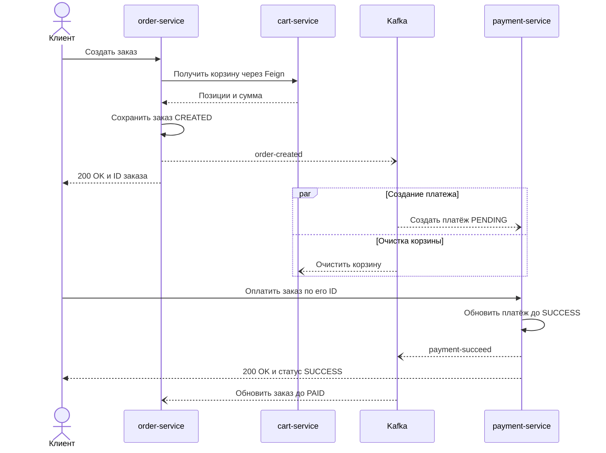

<div align="center">
<h1>Spring E-Commerce</h1>
<p>Учебный бэкенд интернет-магазина на Java 21 и Spring Boot</p>


</div>

---

Пользователь может зарегистрироваться, просмотреть каталог, собрать корзину и оформить заказ. Проект включает семь прикладных сервисов с отдельными базами PostgreSQL, API Gateway и Eureka. Корзина, заказы и симуляция оплаты связаны событиями Apache Kafka.

## Быстрый старт

Из корня проекта запустите Docker Compose.

```bash
docker compose up -d --build
docker compose ps
```

Дождитесь регистрации прикладных сервисов в [Eureka Dashboard](http://localhost:8761). Затем откройте [Swagger UI](http://localhost:8080/swagger-ui.html) или пройдите [пример оформления заказа](#пример-оформления-заказа).

Для запуска приложений из IDE нужны Java 21 и Maven. Поднимите инфраструктуру командой `docker compose up -d postgres redis zookeeper kafka`, дождитесь готовности контейнеров и выполните `mvn clean package`. Запускайте сервисы с профилем по умолчанию, который использует адреса на `localhost`.

При запуске без RSA-ключей `auth-service` создаёт пару в памяти. После перезапуска сервиса войдите снова, чтобы получить новый JWT. Для постоянной пары укажите пути `rsa.private-key` и `rsa.public-key`. Если оба PEM-файла уже есть в `auth-service/src/main/resources/keys`, сервис использует их.

---

## Архитектура

### Сервисы

| Сервис | Порт | База данных | Назначение                                                                  |
|---|---|---|-----------------------------------------------------------------------------|
| **api-gateway** | 8080 | — | Единая точка входа, маршрутизация `lb://service`, агрегированный Swagger UI |
| **eureka-server** | 8761 | — | Service discovery                                                           |
| **auth-service** | 8081 | `credentials` | Регистрация, логин, выпуск JWT (RS256), JWKS                                |
| **user-service** | 8082 | `users` | Профили пользователей                                                       |
| **category-service** | 8083 | `categories` | Категории товаров                                                           |
| **product-service** | 8084 | `products` | Товары                                                                      |
| **cart-service** | 8085 | `carts` | Корзина пользователя                                                        |
| **order-service** | 8086 | `orders` | Заказы                                                        |
| **payment-service** | 8087 | `payments` | Платежи                                                                     |

При первом запуске PostgreSQL с пустым томом Compose выполняет `init/init.sql` и создаёт семь баз данных. Flyway создаёт таблицы и применяет миграции при запуске каждого прикладного сервиса. API Gateway маршрутизирует публичные запросы, а OpenFeign обращается к сервисам по именам через Eureka.

### Межсервисные вызовы (Feign)

| Кто вызывает | Куда | Зачем |
|---|---|---|
| auth-service | user-service | создать пользователя при регистрации |
| cart-service | product-service | проверить товар и цену при добавлении в корзину |
| order-service | cart-service | получить корзину при создании заказа |
| product-service | category-service | проверить существование категории |

---

## Как создаётся и оплачивается заказ

Клиент обращается к API через шлюз. Оплата моделируется сменой статуса платежа в `payment-service`.



Платёж появляется асинхронно после создания заказа. Статус самого заказа обновляется до `PAID` после обработки события `payment-succeed`.

---

## Ключевые решения

### Аутентификация и доступ

- `auth-service` выдаёт JWT с подписью RS256 при регистрации и входе. Публичный ключ доступен по `/.well-known/jwks.json`.
- Пароли хранятся в виде хешей BCrypt. Сервисы проверяют JWT и используют роли `USER` и `ADMIN`. Роль администратора требуется для управления каталогом и просмотра заказов по административному маршруту.
- Внутренние маршруты `/api/v1/internal/**` используются для межсервисных вызовов. Gateway маршрутизирует публичные пути из таблицы API.

### Повторные попытки и обработка ошибок

Для четырёх цепочек Feign используются `Retry` и `CircuitBreaker` из Resilience4j. Настройки предусматривают до трёх попыток с паузой 500 мс. Если вызов не удаётся, fallback возвращает ошибку `503 Service Unavailable`.

### Данные и кэш

- Каждый прикладной сервис работает со своей базой PostgreSQL и получает данные других сервисов через API или события Kafka.
- Flyway применяет миграции при запуске сервисов.
- `category-service` и `product-service` используют Redis для кэширования данных каталога через `@Cacheable`.

---

## API

Публичные маршруты доступны через `http://localhost:8080`. [Swagger UI](http://localhost:8080/swagger-ui.html) объединяет спецификации семи прикладных сервисов.

| Сервис | Метод | Путь | Описание | Доступ |
|---|---|---|---|---|
| auth | POST | `/api/v1/auth/register` | Регистрация, возвращает JWT | свободный |
| auth | POST | `/api/v1/auth/login` | Логин, возвращает JWT | свободный |
| user | GET | `/api/v1/users/me` | Профиль текущего пользователя | authenticated |
| category | GET | `/api/v1/categories` | Все категории | свободный |
| category | GET | `/api/v1/categories/{id}` | Категория по ID | свободный |
| category | POST/PUT/DELETE | `/api/v1/categories[/{id}]` | Управление категориями | **ADMIN** |
| product | GET | `/api/v1/products` | Страница товаров (фильтр по категории, пагинация) | свободный |
| product | GET | `/api/v1/products/{id}` | Товар по ID | свободный |
| product | POST/PUT/DELETE | `/api/v1/products[/{id}]` | Управление товарами | **ADMIN** |
| cart | GET | `/api/v1/carts` | Текущая корзина | authenticated |
| cart | POST | `/api/v1/carts/items` | Добавить товар (`{"productId":1,"quantity":2}`) | authenticated |
| cart | PUT | `/api/v1/carts/items/{id}` | Изменить количество | authenticated |
| cart | DELETE | `/api/v1/carts/items/{id}` | Удалить позицию | authenticated |
| cart | DELETE | `/api/v1/carts` | Очистить корзину | authenticated |
| order | POST | `/api/v1/orders` | Создать заказ из корзины | authenticated |
| order | GET | `/api/v1/orders/my` | Страница своих заказов | authenticated |
| order | GET | `/api/v1/orders/my/{id}` | Свой заказ | authenticated |
| order | GET | `/api/v1/orders/{id}` | Заказ по ID | **ADMIN** |
| payment | POST | `/api/v1/payments/{orderId}/pay` | Оплатить заказ | authenticated |

### Пример оформления заказа

Пример рассчитан на Bash, `curl` и `jq`. Товар с ID `1` добавляется миграцией при первом запуске на пустой базе. Для уже зарегистрированного пользователя получите JWT через `POST /api/v1/auth/login`.

```bash
API=http://localhost:8080

JWT=$(curl -fsS -X POST "$API/api/v1/auth/register" \
  -H "Content-Type: application/json" \
  -d '{"firstname":"John","lastname":"Doe","email":"john@example.com","password":"secret"}')

curl -fsS -X POST "$API/api/v1/carts/items" \
  -H "Authorization: Bearer $JWT" \
  -H "Content-Type: application/json" \
  -d '{"productId":1,"quantity":2}'

ORDER=$(curl -fsS -X POST "$API/api/v1/orders" \
  -H "Authorization: Bearer $JWT" \
  -H "Content-Type: application/json" \
  -d '{"shippingCity":"Москва","shippingStreet":"Тверская","shippingHouse":"1","shippingApartment":"10"}')
ORDER_ID=$(printf '%s\n' "$ORDER" | jq -er '.id')
```

Запустите тестовую оплату для полученного `ORDER_ID`. Если API вернул `404 PAYMENT_NOT_FOUND`, подождите, пока `payment-service` обработает событие создания заказа, и повторите запрос оплаты.

```bash
curl -sS -i -X POST "$API/api/v1/payments/$ORDER_ID/pay" \
  -H "Authorization: Bearer $JWT"
```

Ответ содержит статус `SUCCESS`. Проверить, что заказ перешёл в `PAID`, можно отдельным запросом после обработки события оплаты.

```bash
curl -fsS "$API/api/v1/orders/my/$ORDER_ID" \
  -H "Authorization: Bearer $JWT" | jq -r '.status'
```

---

## Технологии

**Язык и фреймворки.** Java 21, Spring Boot 4.0.6, Spring Cloud 2025.1.2 (Gateway, OpenFeign, Circuit Breaker, Eureka), Spring Security OAuth2 Resource Server, Spring Data JPA, Spring Kafka, Spring Cache.

**Инфраструктура.** PostgreSQL 16, Apache Kafka (Confluent 7.5) + ZooKeeper, Redis 8, Docker Compose.

**Инструменты.** Maven (мульти-модульная сборка), Flyway, MapStruct, Lombok, springdoc-openapi 3.0.3 (Swagger UI).

---

## Структура проекта

```
spring-ecommerce/
├── pom.xml                  # родительский POM (11 модулей)
├── docker-compose.yml       # весь контур: БД, брокер, 9 сервисов
├── init/init.sql            # создание баз данных
├── api-gateway/             # Spring Cloud Gateway + Swagger UI
├── eureka-server/           # service discovery
├── auth-service/            # JWT (RS256), JWKS, роли
├── user-service/            # профили
├── category-service/        # категории + Redis-кэш
├── product-service/         # товары + Redis-кэш
├── cart-service/            # корзина
├── order-service/           # заказы, продюсер/консюмер Kafka
├── payment-service/         # платежи, консюмер/продюсер Kafka
├── common/                  # общие DTO и KafkaTopics
└── clients/                 # Feign-клиенты
```

---

## Что исправлено в ходе разработки

- Вызов регистрации использует общий контракт Feign. При повторном запросе на создание профиля с уже сохранённым email `user-service` возвращает ID существующего профиля. В PostgreSQL действует ограничение уникальности email.
- В Kafka настроены два адреса подключения. Контейнеры используют `kafka:29092`, приложения на хосте — `localhost:9092`.
- Обработчики Kafka используют отдельные группы `payment-group`, `order-group` и `cart-group`. Это позволяет сервисам независимо обрабатывать события, на которые они подписаны.

---

## Лицензия

MIT. Проект создан в учебных целях.
